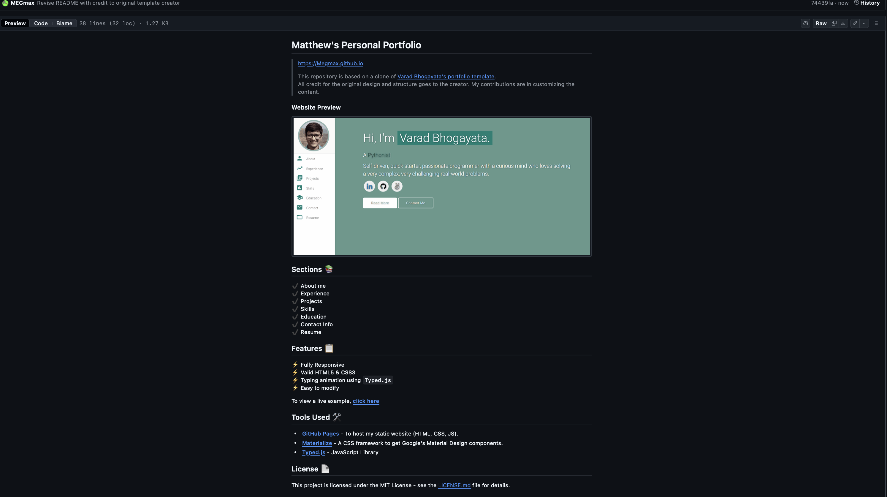
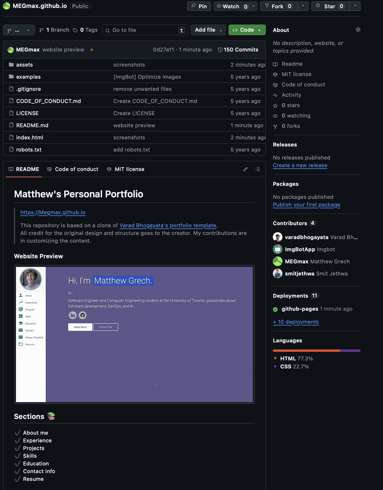
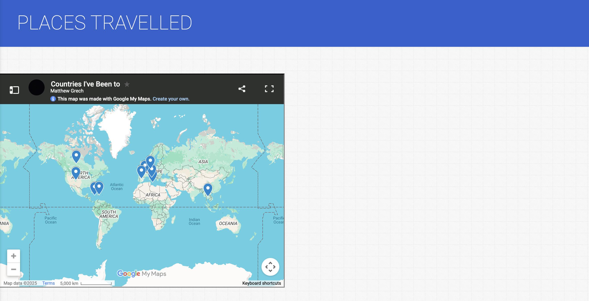
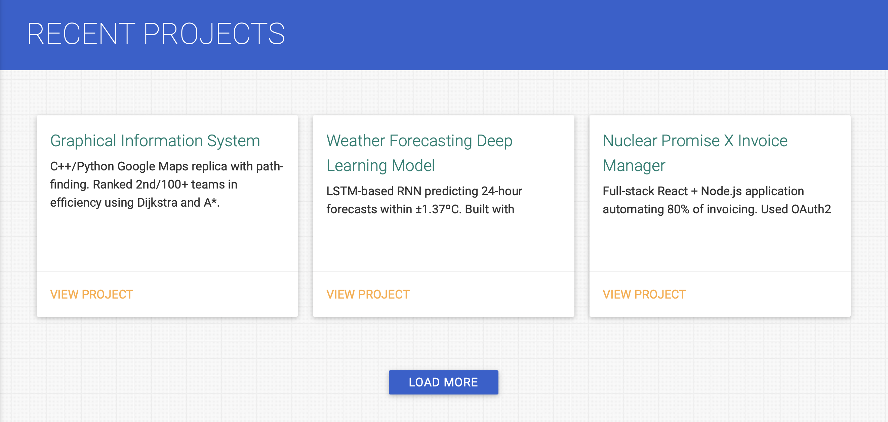

# Matthew's Personal Portfolio 

> https://megmax.github.io
> 
> This repository is based on a clone of [Varad Bhogayata's portfolio template](https://github.com/varadbhogayata/varadbhogayata.github.io).  
All credit for the original design and structure goes to the creator. My contributions are in customizing the content.
### Website Preview

 
  <kbd>
    
  </kbd>

## Sections 📚
✔️ About me\
✔️ Experience\
✔️ Projects \
✔️ Skills \
✔️ Education\
✔️ Contact Info\
✔️ Resume

## Features 📋
⚡️ Fully Responsive\
⚡️ Valid HTML5 & CSS3\
⚡️ Typing animation using `Typed.js`\
⚡️ Easy to modify

To view the live site, **[click here](https://megmax.github.io/)**

## Tools Used 🛠️
* [<b>GitHub Pages</b>](https://create-react-app.dev/docs/deployment/#github-pages) - To host my static website (HTML, CSS, JS).
* [<b>Materialize</b>](https://materializecss.com/) - A CSS framework to get Google's Material Design components.
* [<b>Typed.js</b>](https://mattboldt.com/demos/typed-js/) - JavaScript Library
* [<b>Devicon</b>](https://devicon.dev/) - Skill logos (MIT), self-hosted in `assets/img/skills/`

## License 📄
This project is licensed under the MIT License - see the [LICENSE.md](./LICENSE) file for details.

## ECE444 Lab 1

### Activity 1- Cloning personal website repo into your own GitHub account.

### Activity 2- Adding your personal information.

### Activity 3- Changing the Theme Color of Your Personal Website.

### Activity 4- Creating new section and embedding Google Maps

### Activity 5- Adding Dynamic Content with JavaScript.

